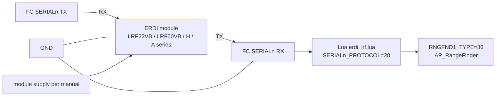
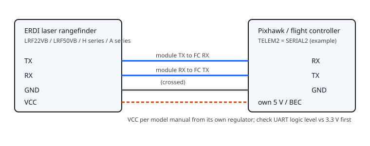

# ERDI laser rangefinder on Pixhawk / ArduPilot

Datasheets and public prices are on the [LRF22VB page](https://erdilrf.com/models/lrf22vb/?utm_source=github&utm_medium=readme&utm_campaign=erdi-lrf-pixhawk-ardupilot) and in the [full ERDI laser rangefinder model list](https://erdilrf.com/models/?utm_source=github&utm_medium=readme&utm_campaign=erdi-lrf-pixhawk-ardupilot).

How to connect an **ERDI 905 nm laser rangefinder module to a Pixhawk flight controller running ArduPilot** (Copter, Plane, Rover): wiring diagram, parameter table, a **Lua scripting driver** you can use today on stock ArduPilot, and the status of the **native driver pull request [ArduPilot/ardupilot#34983](https://github.com/ArduPilot/ardupilot/pull/34983)**. Typical uses: **drone altimeter / terrain following / precision landing** with an LRF22VB (1.5 g, 20 m) or LRF50VB, longer-range H-series modules (50 to 1500 m) for survey and inspection, and A-series modules (LRF3000A1, 1 to 3000 m).

> **Status (2026-11-06).** The Lua driver passes its protocol tests but has **not been flight-tested on a flight controller**. The native driver PR is open and not merged. Bench-test with props off before any flight. Do not describe either as "supported by ArduPilot" until upstream merges and documents it.

## Option 1: Lua scripting driver (stock firmware)

1. Wire the module to a free flight-controller UART ([wiring](docs/wiring.svg), diagram below).
2. Set parameters (example: SERIAL2 / TELEM2, LRF22VB), then reboot:

   | Parameter | Value |
   |---|---|
   | `SCR_ENABLE` | 1 |
   | `SCR_HEAP_SIZE` | 150000 or more |
   | `SERIAL2_PROTOCOL` | 28 (Scripting) |
   | `RNGFND1_TYPE` | 36 (Lua scripts) |
   | `RNGFND1_ORIENT` | 25 (downward) |
   | `RNGFND1_MIN` / `RNGFND1_MAX` | from [docs/parameters.md](docs/parameters.md) (metres) |

3. Copy [`scripts/erdi_lrf.lua`](scripts/erdi_lrf.lua) to the SD card folder `APM/scripts/` and reboot.
4. Set the `ERDI_*` parameters for your model (table in [docs/parameters.md](docs/parameters.md)): for LRF22VB `ERDI_MODE=0`, `ERDI_BR=460800`, `ERDI_UNIT=0.001`, `ERDI_LEN=4`, `ERDI_OOR=20000`.
5. Check `RFND` in the log or the Mission Planner / QGroundControl rangefinder display against a tape measure. Full procedure: [docs/hardware-test-checklist.md](docs/hardware-test-checklist.md).





Cross TX and RX, share ground, and check the module's UART logic level against the flight controller's 3.3 V before connecting. Power the module from its own supply as its manual says; TELEM connector 5 V pins are not automatically right for every model (LRF22VB is a 3.0 to 3.6 V part). Pin order differs by flight controller: use your board's pinout page.

## Option 2: native driver (pull request, not merged)

[ArduPilot PR #34983](https://github.com/ArduPilot/ardupilot/pull/34983), "AP_RangeFinder: add ERDI VB and H series serial rangefinders", adds a C++ serial backend, a SITL simulator and autotest coverage for the 4-byte `0x5C` stream:

- `RNGFNDx_TYPE = 49` (ERDI-VB-Serial): LRF10VB, LRF22VB, LRF50VB, distance in millimetres
- `RNGFNDx_TYPE = 50` (ERDI-H-Serial): LRF50H, LRF100H, LRF200H, LRF300H, LRF600H, distance in centimetres

The PR notes SITL autotest results and a factory bench run of an LRF22VB and an LRF50H through a USB-TTL adapter; flight-controller logs are still to come. Bench evidence: <https://github.com/ErdiTech/erdi-lrf-drivers/tree/main/docs/evidence/ardupilot-bench-20261105>. Until the PR is merged and appears in a firmware release, use Option 1 or a companion computer ([erdi-lrf-raspberry-pi-python](https://github.com/ErdiTech/erdi-lrf-raspberry-pi-python) sends MAVLink `DISTANCE_SENSOR`).

## Models and units

The VB series counts **millimetres**, the H series **centimetres**: `5C 02 11 EC` is 4.354 m on an LRF22VB and 43.54 m on an LRF100H. Use the exact model's row in [docs/parameters.md](docs/parameters.md). Model pages, datasheets and prices: <https://erdilrf.com/models/?utm_source=github&utm_medium=readme&utm_campaign=erdi-lrf-pixhawk-ardupilot>.

## Tests

```bash
python3 tests/protocol_fixtures.py        # prints: PASS: 9 ERDI protocol assertions
python3 -m pytest -q tests
luac5.3 -p scripts/erdi_lrf.lua           # Lua syntax check (CI)
```

The fixtures check frame parsing rules against manual examples; they do not replace SITL or bench testing.

## Related projects

- [ErdiTech/erdi-lrf-drivers](https://github.com/ErdiTech/erdi-lrf-drivers): protocol library and flight-controller integration notes
- [drone-altimeter-laser-rangefinder-guide](https://github.com/ErdiTech/drone-altimeter-laser-rangefinder-guide): selection guide for drone laser altimeters
- [laser-rangefinder-module-database](https://github.com/ErdiTech/laser-rangefinder-module-database): dataset of laser rangefinder modules

## Support / 打赏

If this project saved you time, you can buy the author a coffee in crypto. Thank you!
如果这个项目帮到了你，欢迎用加密货币打赏支持，谢谢！

| Network | Asset | Address |
|---|---|---|
| TRON (TRC20) | USDT | `TNGdTwE6opH6rmUyoG1JUR7FSyEb4k273R` |
| Ethereum / BNB Chain / Polygon | USDT | `0x59c43144a862b351fa1086ae842d1327c9d91613` |
| Ethereum / Arbitrum / Base | ETH | `0x59c43144a862b351fa1086ae842d1327c9d91613` |
| Bitcoin | BTC | `1RS6tWXHregLfEsiPzVUCUBuhgDg5uTSV` |
| Solana | USDT | `HZguEXfTtLChNdJTxAYCbcGscaqikz8JYrEpUhEyeVd9` |

Please send only the listed asset on the listed network — other tokens or networks may be lost.
请按表中对应的网络转对应的币种，转错币种或网络可能无法找回。


## License

MIT — see [LICENSE](LICENSE).
